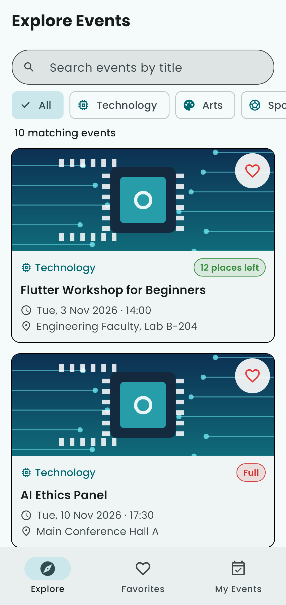
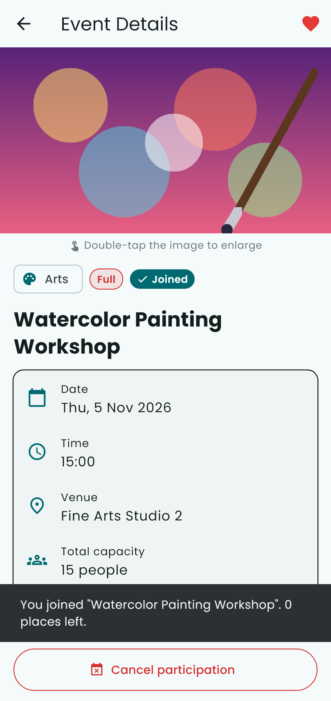
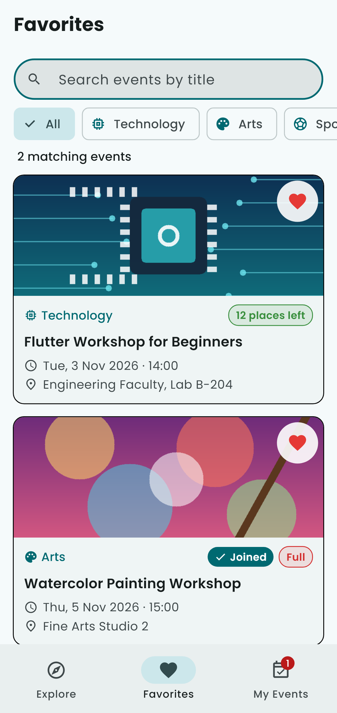
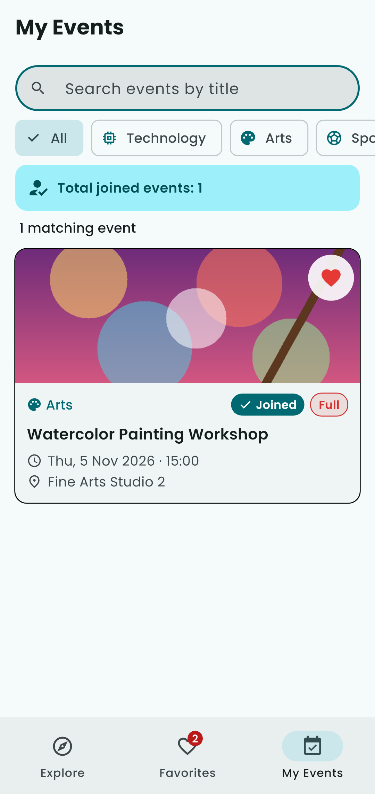
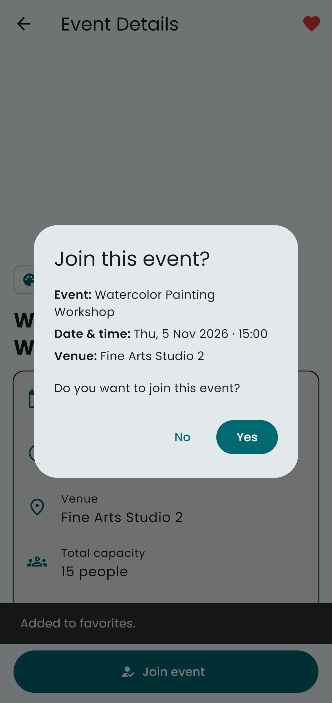
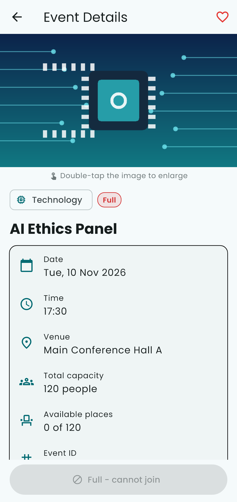
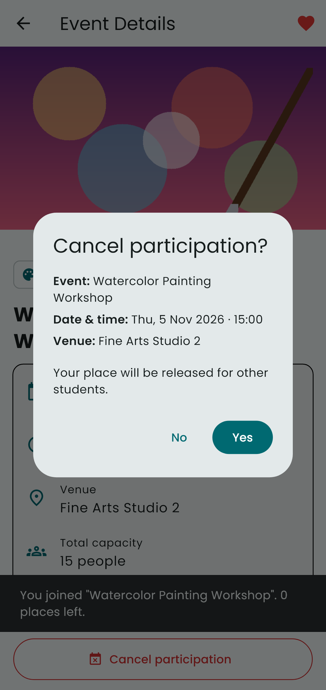
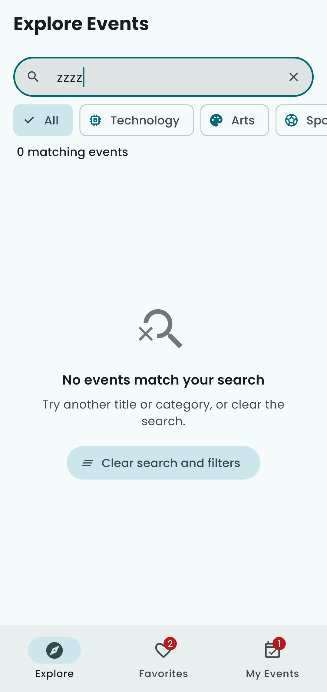

# Campus Event Explorer

BIM493 – Mobile Programming I · Assignment #1 (2026–2027)

A Flutter mobile app that helps students discover campus events, save
favorites and manage their own participation. All data is fictional and stored
in Dart code, so the app works fully offline after installation.

## Team

| Full name | Student ID | Contribution |
|-----------|------------|--------------|
| Muhammed Emin Turan | 10112205552 | Event data and model, `EventStore` (join/cancel/favorite logic), search and filter, unit tests |
| Kayra Özgül | 19043106600 | Screens and widgets (Explore, Favorites, My Events, details, image viewer), dialogs, images/font, README and screenshots |

## Flutter version

Built with Flutter **3.47.6 (stable channel)**. Output of `flutter --version`:

```
Flutter 3.47.6 • channel stable • https://github.com/flutter/flutter.git
Framework • revision 5fc346839b (4 weeks ago) • 2026-09-30 15:02:49 -0700
Engine • hash b8c8d3d8d5d0095127057f8a29ca8cc53da2167c (revision 692136cb65) (25 days ago) • 2026-09-30 00:56:59.000Z
Tools • Dart 3.13.5 • DevTools 2.60.0
```

## Setup and run

```bash
flutter pub get
flutter run
```

Run the tests:

```bash
flutter test
```

Build an Android APK (optional):

```bash
flutter build apk --release
```

If the platform folders (`android/`, `ios/`, …) are missing, generate them
without touching `lib/` with:

```bash
flutter create --project-name campus_event_explorer --platforms android,ios .
```

## Features

**Event data and Explore screen**
- 10 fictional events in 4 categories (Technology, Arts, Sports, Career), each
  with a unique ID, title, category, date/time, venue, description, local
  image, total capacity and initial available places.
- *AI Ethics Panel* (`evt-02`) starts **full**; *Watercolor Painting Workshop*
  (`evt-04`) starts with **exactly one** available place.
- All dates are in November 2026, after the deadline.
- Scrollable cards with image, title, category, date/time, venue,
  availability label (Full / Only 1 place left / N places left), a "Joined"
  badge and a favorite (heart) button.

**Search and category filter**
- Title search that ignores letter case and surrounding spaces.
- "All" plus four category chips. Search and category work together and the
  number of matching events is shown.
- Readable empty-state message with a **Clear search and filters** button; the
  search field also has a clear (×) icon.
- The same search/filter settings apply to Explore, Favorites and My Events.

**Details and image viewer**
- Details screen shows every field of the event, a favorite control (AppBar)
  and a participation button.
- **Double-tap** the image to open an enlarged, zoomable image screen
  (Hero animation). Both screens use the normal Back navigation.
- Returning to the list shows the updated state.

**Favorites and My Events**
- Three views with a bottom `NavigationBar`: Explore, Favorites, My Events.
- Favorites shows only favorited events, My Events only joined events; both
  have empty-state messages. Badges show the number of favorites and joined
  events; My Events also shows **Total joined events: N**.
- Favorites never change participation or capacity.

**Join and cancel participation**
- *Join event* opens a confirmation dialog showing title, date/time and venue
  with **No / Yes**. No or dismissing the dialog changes nothing; Yes joins
  once, decreases available places by one and shows a SnackBar.
- A joined event offers *Cancel participation* with a confirmation dialog;
  confirming removes it from My Events and restores one place.
- Joining twice is impossible (no duplicates, capacity never decreases twice).
- An unjoined event with zero places is labelled **Full** and its button is
  disabled. A student who took the last place can still cancel.

**Layout, assets and font**
- `MaterialApp`, `Scaffold`, `Row`, `Column`, `Padding`, `Expanded`, etc.
- Reusable `StatelessWidget`s: `EventCard`, `AvailabilityLabel`,
  `EmptyState`, `SearchFilterBar`, `InfoRow`.
  `StatefulWidget`s: `HomeScreen`, `EventDetailsScreen`.
- Only `setState` is used for state management (no extra libraries).
- Images and the **Poppins** font are bundled locally and declared in
  `pubspec.yaml`.

## Project structure

```
lib/
  main.dart                      MaterialApp + theme (Poppins font)
  models/campus_event.dart       CampusEvent model, EventCategory enum
  data/events_data.dart          Fictional event list
  state/event_store.dart         In-memory favorites / participation / filter
  utils/date_format.dart         Date and time formatting
  screens/home_screen.dart       Explore / Favorites / My Events + bottom nav
  screens/event_details_screen.dart
  screens/image_viewer_screen.dart
  widgets/                       EventCard, SearchFilterBar, EmptyState, ...
assets/images/                   Category images
assets/fonts/                    Poppins font files + OFL license
test/                            Unit and widget tests
tool/generate_images.py          Script that generated the images
screenshots/                     Screenshots for this README
```

## Screenshots

| Explore | Details | Favorites | My Events |
|---------|---------|-----------|-----------|
|  |  |  |  |

| Join dialog | Full event | Cancel dialog | Empty search |
|-------------|------------|---------------|--------------|
|  |  |  |  |

The screenshots are rendered by `test/screenshots_test.dart` with the real
Poppins font (`flutter test test/screenshots_test.dart --update-goldens`).

## Test checklist

| Case | Steps | Expected | Result |
|------|-------|----------|--------|
| Full event | Open *AI Ethics Panel* | Label "Full", join button disabled | ☐ Checked |
| Last place | Join *Watercolor Painting Workshop* → Yes | Becomes Full, appears in My Events, joined count = 1 | ☐ Checked |
| Cancel dialog – No | On a joined event tap *Cancel participation* → No | Still joined, places unchanged | ☐ Checked |
| Cancel dialog – Yes | Tap *Cancel participation* → Yes | Removed from My Events, one place restored | ☐ Checked |
| Join dialog dismissed | Tap *Join event*, tap outside the dialog | Nothing changes | ☐ Checked |
| Duplicate join | Join an event, go back, open it again | Only *Cancel* is offered; places decreased once | ☐ Checked |
| Empty search | Type `zzzz` in search | "No events match your search" + clear button | ☐ Checked |
| Case/space search | Type `  JAZZ ` | *Campus Jazz Night* is found | ☐ Checked |
| Search + category | Type `workshop`, select *Arts* | Only *Watercolor Painting Workshop* | ☐ Checked |
| Favorites consistency | Favorite on a card, unfavorite in details | Favorites view updates both times | ☐ Checked |
| Image viewer | Double-tap image in details, press Back | Enlarged image opens and closes | ☐ Checked |

Automated tests in `test/` cover the same rules (`flutter test`).

## Credits and licenses

- **Images** (`assets/images/*.png`): original illustrations generated for
  this project by `tool/generate_images.py`. No third-party content.
- **Font**: [Poppins](https://fonts.google.com/specimen/Poppins) © 2020 The
  Poppins Project Authors (Indian Type Foundry), downloaded from the
  [google/fonts](https://github.com/google/fonts/tree/main/ofl/poppins)
  repository and licensed under the SIL Open Font License 1.1.
  The license is included at `assets/fonts/OFL.txt`.
- **Icons**: Material Icons included with Flutter (Apache License 2.0).

## Known limitations

- Favorites and participation are kept in memory only; they reset when the
  app is restarted (as allowed by the assignment).
- Event data is fixed in code; there is no login, backend or real booking.
- The UI text is English only.
